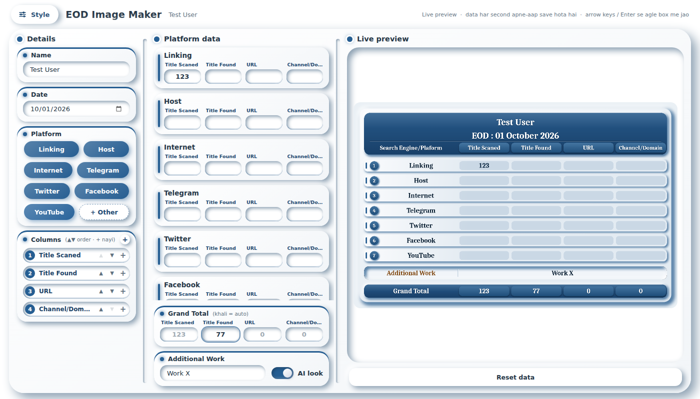

# EOD Image Maker

Roz ka **EOD (End of Day) report** ek saaf, neumorphism-style **image** me badal deta hai. Form bharo aur live preview me image turant dekho. Apna design ek baar set karo, phir roz sirf numbers bharo.



## Features

- **3 sections** – Details · Platform data · Live preview. Platform data me sirf platform cards scroll hote hain; **Grand Total aur Additional Work hamesha neeche fixed** rehte hain.
- **Apna design, apna default** – `Style` button se colour, font, size, layout aur columns set karo, phir **Set as default** dabao. Wahi aapka default design ban jata hai. `Default` = saved design wapas, `Factory` = original design.
- **Auto-sync** – data har second apne-aap save hota hai. Jab bhi dobara kholo, bilkul wahin se khulta hai jahan chhoda tha.
- **Reset data** – ek button jo sirf data saaf karta hai (numbers, Grand Total, Additional Work, date = aaj). Design / formatting nahi badalti. Galti se bachne ke liye 2 baar dabana padta hai.
- **Columns ka order tumhare haath me** – ▲▼ se order, `+` se nayi column (maximum 6 extra), extra column hata bhi sakte ho.
- **Multi colour = tumhare main colour ka theme** – UI aur image dono usi theme me.
- **Grand Total auto** – khali chhodo to automatic (kuch columns max, kuch sum).
- **Keyboard** – arrow keys / Enter se agle box me, `Ctrl+Enter` se image refresh.
- Sab data tumhare browser me hi rehta hai. Koi server ya network request nahi.

> Image copy karne ke liye: preview image par **ek click** karo, phir kahin bhi paste karo. (Backup: right-click → Copy image.)

## Use karne ke 2 tareeke

### 1) Seedha browser me (sabse aasaan)

Saari files repo ke **root me** upload karo (koi folder nahi). Phir **Settings → Pages → Source: Deploy from a branch → Branch: main, folder: / (root)** chun ke Save karo. Kuch der me app is link par chalega:

```
https://<github-username>.github.io/<repo-name>/
```

Bas ye link users ko bhej do. Har user ka data aur default design uske apne browser me save hota hai.

### 2) Chrome extension (Chrome / Edge / Brave)

1. Repo ko **Code → Download ZIP** se download karke extract karo (ya `git clone`).
2. Browser me `chrome://extensions` kholo.
3. Upar right me **Developer mode** ON karo.
4. **Load unpacked** dabao aur wo folder chuno jisme `manifest.json` hai.
5. Toolbar me **EOD Image Maker** icon par click karo – app naye tab me khulega.

> Update karne ke liye: naye files folder me daalo aur `chrome://extensions` me extension par reload (⟳) dabao.

## Roz ka flow

1. Pehli baar: `Style` me apna design banao → **Set as default**.
2. Naam aur date bharo, platforms chuno (`+ Other` se apna platform jodo).
3. Numbers bharo. Preview turant update hoti hai, data apne-aap save hota hai.
4. Agle din: **Reset data** dabao aur naye numbers bharo. Design wahi rahega.

## Project structure

Sab files ek hi level par hain (koi folder nahi), taaki GitHub par ek saath upload ho jayein.

```
index.html      page ka structure (GitHub Pages ka home page)
app.css         neumorphism UI
app.js          form, columns, style drawer, default design, auto-sync, image copy
render.js       canvas par image banane wala engine + colour palette
manifest.json   Chrome extension (Manifest V3)
background.js   toolbar icon par click -> app tab kholta hai
icon16/48/128.png  extension icons
screenshot.png  README ka screenshot
```

## Development

Build step nahi hai – plain HTML/CSS/JS. Files edit karo aur browser/extension reload karo.
`index.html` ko seedha browser me kholne par bhi chalta hai (data `localStorage` me save hota hai).

## License

[MIT](LICENSE)
